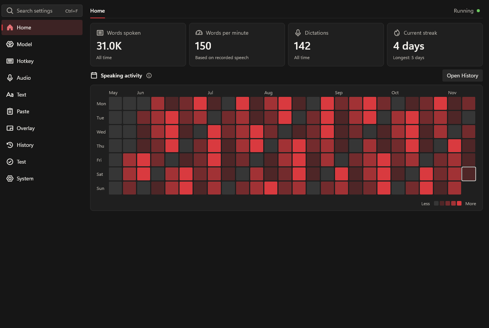
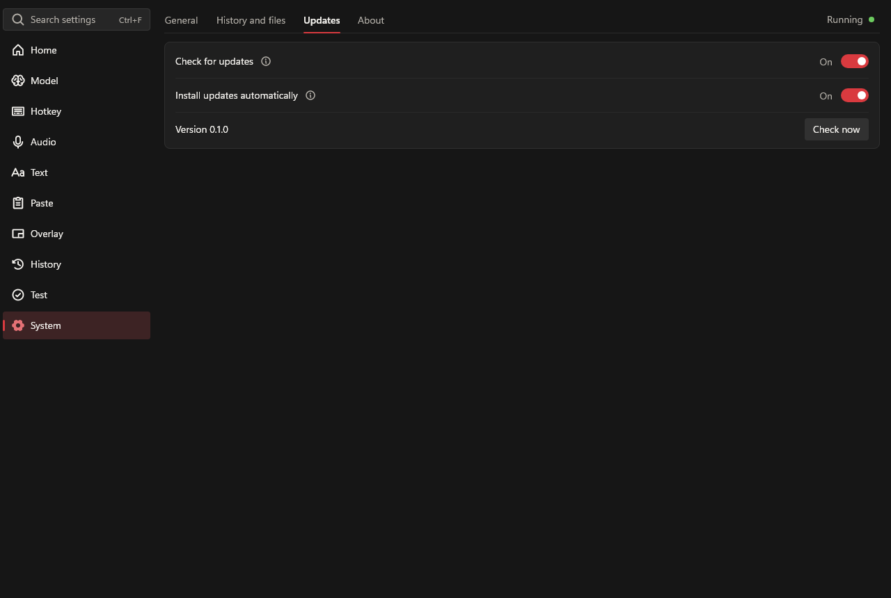
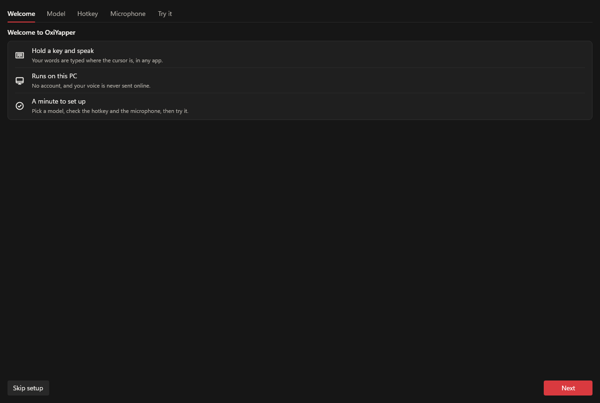
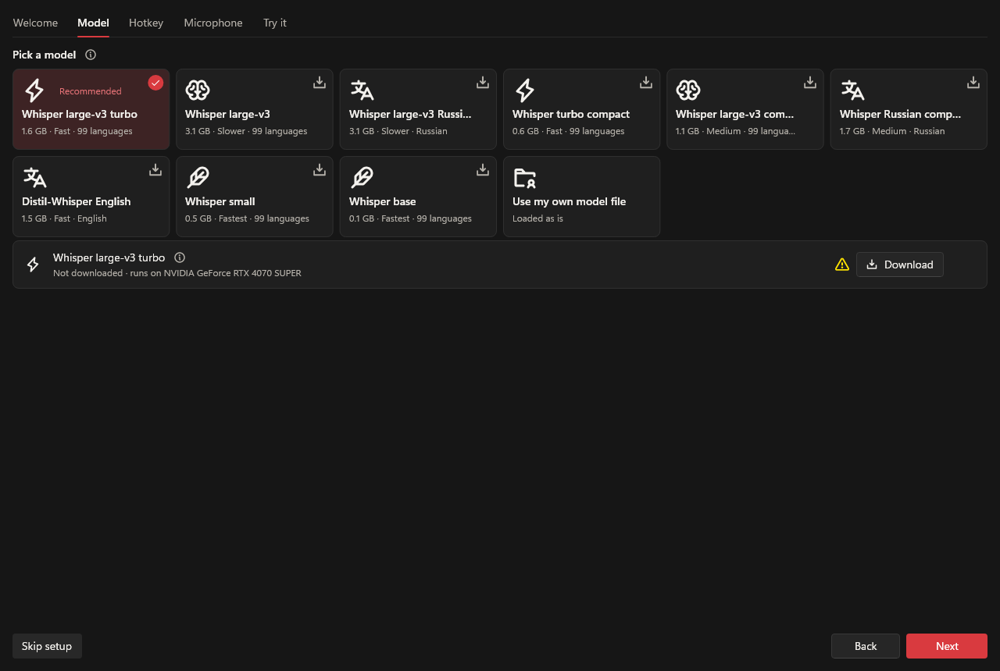
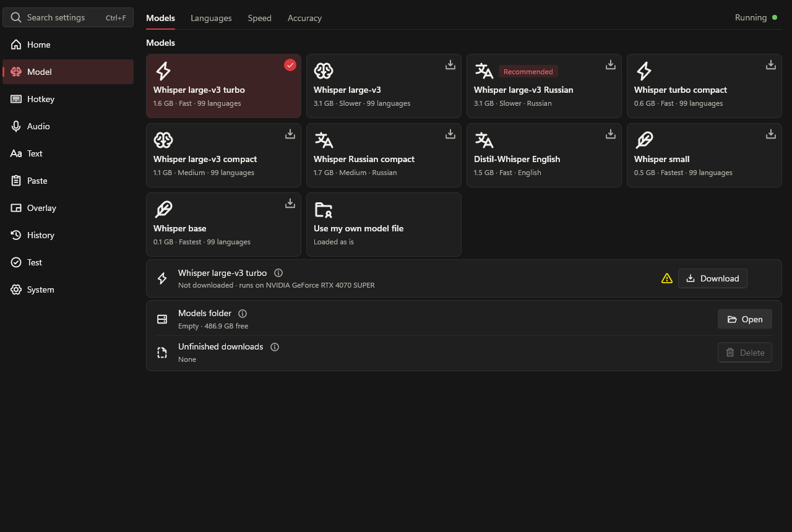
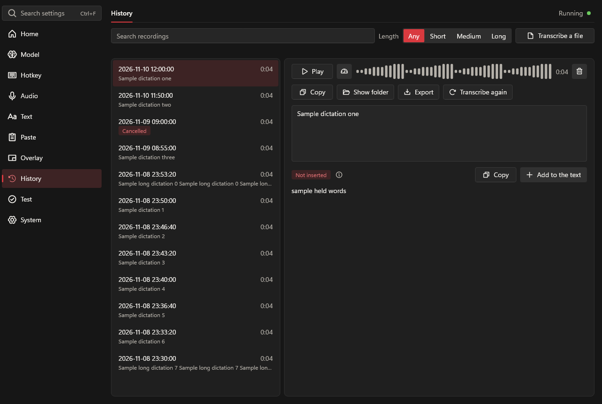
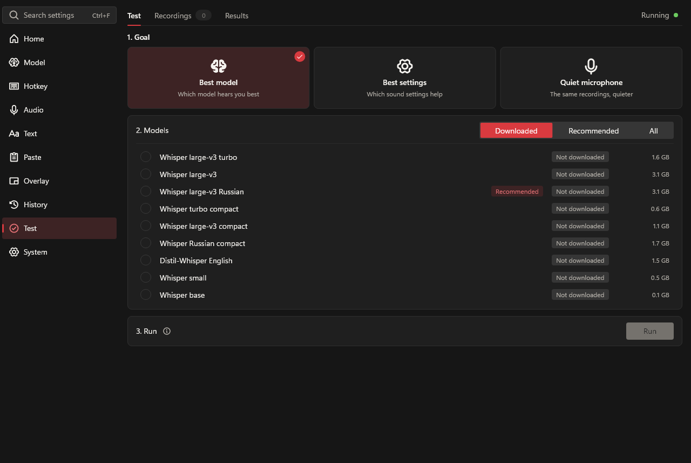
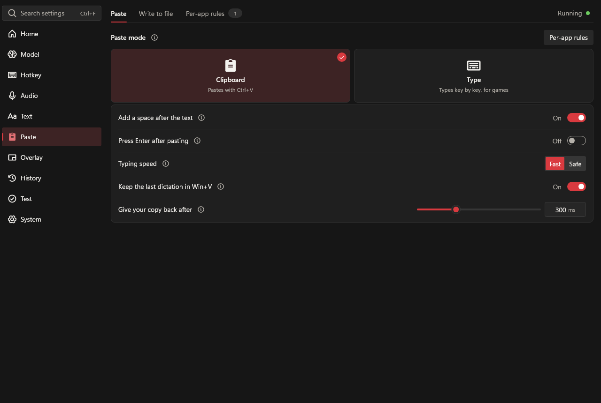
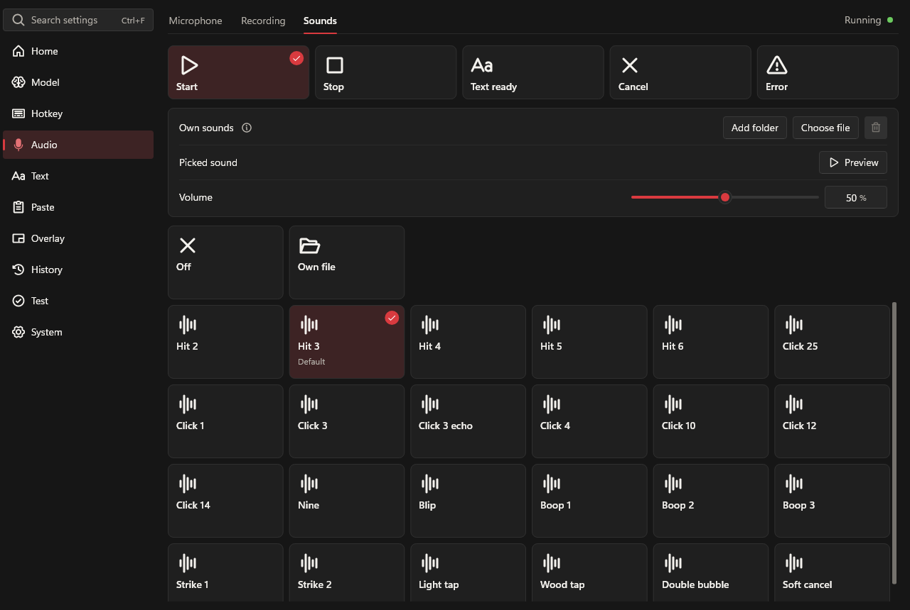
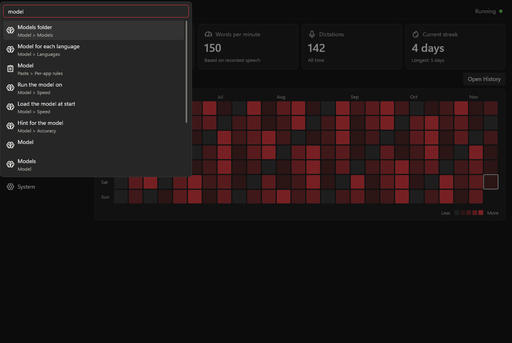

# OxiYapper

Hold a hotkey, speak, let go: your words appear in whatever field has focus. Speech recognition runs on your own computer with [whisper.cpp](https://github.com/ggml-org/whisper.cpp), on the graphics card when there is one.

<picture>
  <source media="(prefers-color-scheme: dark)" srcset="docs/img/home-dark.png">
  <source media="(prefers-color-scheme: light)" srcset="docs/img/home-light.png">
  
</picture>

**Status: early (0.1).** Windows 10 and 11 (64-bit) only for now. Linux and macOS are not supported yet; they may come later, once there is a way to test them.

## What it does

**Dictation**
- Push-to-talk (hold the keys) or toggle (press to start, press to stop). In push-to-talk, a double tap locks recording on. Default hotkey: **Ctrl+Win**; any chord can be set on a clickable on-screen keyboard.
- Text is pasted with the clipboard, and your own clipboard content is put back afterwards. A Type mode types the text instead, for games, terminals and remote desktops. Per-app rules can change the mode, speed, language, model and text options for one program.
- A small overlay pill with a live volume meter shows that it is listening. It never takes focus, so it is safe over a fullscreen game. Start, stop and "text ready" sounds, with your own sound files allowed.
- Dictate in any of Whisper's 99 languages. The language is Auto by default (detected for each dictation); you can pin one. A different model can be set per language.

**Text**
- A dictionary of names and rare words that Whisper should spell right, with a counter for how much of it the model can take.
- Replacements (`heard => wanted`), filler-word removal, phrase shortcuts (say a short trigger, get a stored text), punctuation from pauses, and voice commands (new line, new paragraph, delete the last sentence). All off by default.
- Optional: no full stop at the end, small first letter, hold back words Whisper was unsure of.
- Suggestions learned from your past dictations and edits (words to add, habits to switch on). Nothing changes until you press Apply.
- Can also write each dictation to a daily text or Markdown file.

**Audio**
- Microphone picker, boost, loudness levelling, silence trimming, noise reduction (off / light / medium / strong / auto), a low-rumble filter, and settings kept per microphone.
- A 3-second microphone check that tells you if you are too quiet or too loud.

**History and testing**
- Each dictation is saved (audio + text) in a local folder you choose, kept 30 days or 2 GB by default; can be turned off. Play, copy, transcribe again, export, or transcribe an audio file (wav, ogg, mp3, m4a, flac). The format is documented in [docs/HISTORY-FORMAT.md](docs/HISTORY-FORMAT.md).
- A Test page compares models and settings on your own recent recordings and shows the error rate of each, so you can pick the best one for your voice.
- Home page with daily counts: dictations, words, speaking time and speed.

**Settings window**
- Light and dark theme, accent colours, a search box (Ctrl+F) that finds any setting and highlights it.
- Starts at sign-in by default; lives in the tray. A setup wizard on first run, and automatic updates.

## Privacy

- Your audio and text never leave your computer. Recognition is local.
- The app goes online for two things only:
  1. Downloading a model you pick (from Hugging Face, pinned to a fixed version and checked by SHA256).
  2. Checking for a new version once a day (GitHub only). The request carries no personal data, only the user agent `OxiYapper/<version>`. It can be turned off in System > Updates.
- All network code is in one module with a fixed list of allowed hosts (Hugging Face and GitHub).
- No telemetry, no accounts, no crash uploads.
- By default, logs hold timings and errors, never what you said (System > History and files > Log dictated text turns that on for debugging).
- History, usage stats and settings are plain files on your disk (`%APPDATA%\OxiYapper\` and `%LOCALAPPDATA%\OxiYapper\`). History can be turned off in System > History and files.

## Download and install

Go to [Releases](https://github.com/makarasty/OxiYapper/releases). Every change on `main` is published as a pre-release that replaces the previous one; a stable release, once there is one, stays beside it until the next. So there is at most one of each, and the pre-release is the newer. Pick a file:

| File | Pick it if |
|---|---|
| `OxiYapper-<version>-windows-x64.zip` | You are not sure. The exe plus the C++ runtime DLLs: unzip anywhere and run it, on a clean Windows too, nothing to install. |
| `OxiYapper-<version>-windows-x64.exe` | You want the bare exe. It needs the [Microsoft Visual C++ Redistributable](https://learn.microsoft.com/cpp/windows/latest-supported-vc-redist) (x64) installed. |
| `SHA256SUMS` | To check your download: `certutil -hashfile <file> SHA256` and compare. |

Each file also has build provenance, which you can check with `gh attestation verify <file> --repo makarasty/OxiYapper`.

**Windows SmartScreen.** The binaries are not code-signed yet, so Windows may show "Windows protected your PC" on first start. Click **More info**, then **Run anyway**.

**Portable mode.** The zip is portable: it holds an empty file named `portable` next to `OxiYapper.exe`, so settings, models and history stay in a `data` folder beside it. For the bare exe, put that file next to it yourself.

**Updates.** OxiYapper checks GitHub once a day and, when you are not dictating, installs a newer version by itself and restarts. Under System > Updates you can switch the check or the automatic install off, or press **Check now**. If the folder cannot be written to, or the install switch is off, you get the download page instead.

## First run

On the first start a short setup wizard opens: **Welcome**, **Model**, **Hotkey**, **Microphone** and **Try it**. Skip it at any time; to see it again, use System > General > **Run setup again**.

| | |
|---|---|
|  |  |

1. Start `OxiYapper.exe`. An icon appears in the tray (it may be under the `^` arrow).
2. In the wizard (or on the **Model** page) download the model marked **Recommended**; it is picked for your graphics card, memory and language. Whisper large-v3 turbo is a good default.
3. The language is **Auto**, detected for each dictation. To pin one, use **Model > Languages**.
4. Click into any text field, hold **Ctrl+Win**, speak, let go. The text appears.

The settings open from the tray icon (click it, or right-click and choose **Settings**), or by starting `OxiYapper.exe` again.

If nothing is pasted, the overlay or the tray icon says why (for example "No speech model. Open Settings to download one").

## Models

All are downloaded from Hugging Face inside the app. You can also use your own whisper.cpp `.bin` file.

| Model | Download | Memory to run | Languages | Speed | Good for |
|---|---|---|---|---|---|
| Whisper large-v3 turbo | 1.6 GB | 2.3 GB | 99 | Fast | Most people: fast and nearly as accurate as large-v3 |
| Whisper large-v3 | 3.1 GB | 3.9 GB | 99 | Slower | The most accurate; wants a strong graphics card |
| Whisper large-v3 Russian | 3.1 GB | 3.9 GB | Russian | Slower | Russian, the most accurate there |
| Whisper turbo compact | 0.57 GB | 1.3 GB | 99 | Fast | Turbo for a card with little memory, or no card |
| Whisper large-v3 compact | 1.1 GB | 2.1 GB | 99 | Medium | Close to large-v3 at half the memory |
| Whisper Russian compact | 1.7 GB | 2.7 GB | Russian | Medium | The Russian model, nearly twice as fast |
| Distil-Whisper English | 1.5 GB | 2.2 GB | English | Fast | English only, fast and accurate there |
| Whisper small | 0.49 GB | 0.9 GB | 99 | Fastest | A PC without a graphics card; less accurate |
| Whisper base | 0.15 GB | 0.4 GB | 99 | Fastest | A weak PC; the least accurate |

"Memory to run" is graphics memory on a graphics card, or system memory on the processor. Model > Speed > **Run the model on** picks the device (Auto, processor, or a listed graphics card).

## System requirements

- Windows 10 or 11, 64-bit, on a CPU with AVX2 (most CPUs of the last decade).
- The zip needs nothing else. The bare exe needs the [Microsoft Visual C++ Redistributable](https://learn.microsoft.com/cpp/windows/latest-supported-vc-redist) (x64); most PCs already have it.
- A graphics card is optional. With an up-to-date driver that provides Vulkan (NVIDIA, AMD, Intel) the model runs on the card. Without Vulkan, OxiYapper still starts and runs on the processor, only slower.
- A microphone, and disk space and memory for the model you pick (table above).

## FAQ and troubleshooting

**Ctrl+Win does nothing.** Check that the tray icon is there. Another dictation tool on the same keys can take them first; quit it or change the hotkey on the Hotkey page.

**Text does not appear in one program.** Programs running as administrator do not accept input from normal ones; the overlay then says "Admin window: press Ctrl+V" and the text is on the clipboard. For games, remote desktops and some terminals, set Paste mode to Type, for all apps or in a per-app rule.

**It is slow.** Check Model > Speed: "Run the model on" should show your graphics card. If it says the processor, try a compact or small model, and update the graphics driver (it provides Vulkan).

**Wrong words for names and terms.** Add them to Text > Dictionary, or fix them with Text > Replacements.

**The last word is cut.** Audio > Recording > "Don't cut my words": pick Careful.

**Where are my files?** System > History and files shows the folders and opens them. Logs are in `%LOCALAPPDATA%\OxiYapper\data\logs\`.

**How do I remove it?** Turn off "Start at sign-in" (System > General), quit from the tray, then delete the folder you unzipped (in portable mode that holds everything) and `%APPDATA%\OxiYapper` and `%LOCALAPPDATA%\OxiYapper`.

## Gallery

| | |
|---|---|
|  |  |
|  |  |
|  |  |

## Building from source

See [CONTRIBUTING.md](CONTRIBUTING.md). Report security issues as described in [SECURITY.md](SECURITY.md). Changes per version are in [CHANGELOG.md](CHANGELOG.md).

## License

Licensed under either of [Apache License 2.0](LICENSE-APACHE) or [MIT](LICENSE-MIT) at your option.

Built with [whisper.cpp](https://github.com/ggml-org/whisper.cpp) and [Slint](https://slint.dev).
